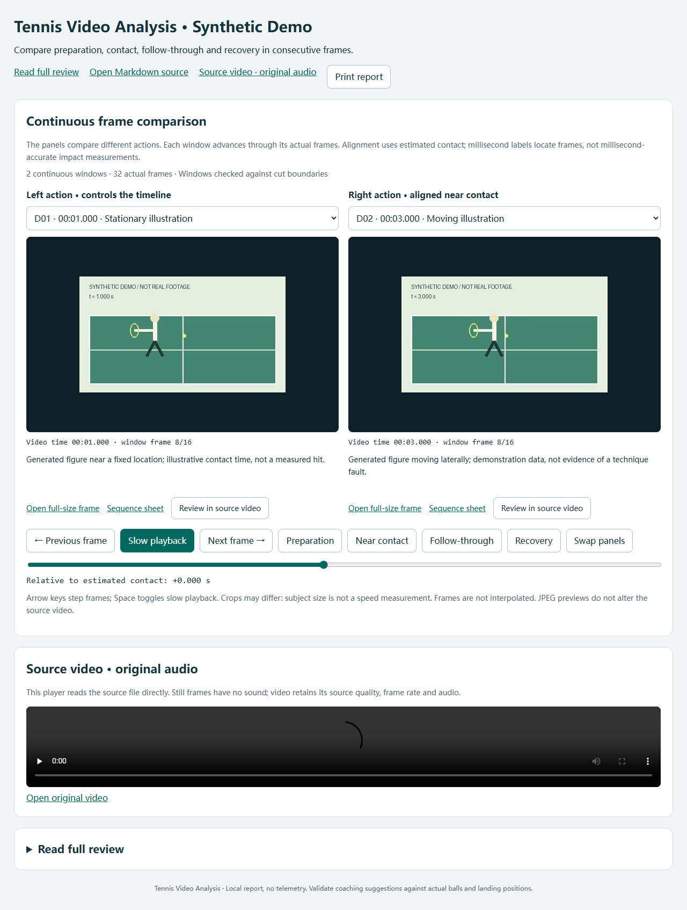

# 网球视频动作分析 Skill

[English](README.md) · [MIT 许可证](LICENSE) · [Skill 入口](skills/tennis-video-analysis/SKILL.md)


**把引拍、触球、随挥和回收连起来分析。** 这是一个可复用的 agent skill 和 Python 工具集：整理视频证据，辅助逐帧观察，再生成包含完整文字分析和互动对比的本地 HTML。

工具负责取帧、校验和展示；动作判断需要 agent 或教练实际查看画面后撰写。它不会自动筛出成功球、判断技术缺陷或给动作打分。



*公开示例由程序绘制人物、球场和示意音轨，不包含真实球员影像、私人报告或本机路径。*

## 功能

- 可安装的 `tennis-video-analysis` skill，包含观察原则、网球分析参考、报告结构和可执行脚本。
- 读取分辨率、帧率、时长和音轨，先生成概览图，再提取重点窗口的真实连续帧。
- 保留实际帧时间，支持可变帧率；填写已知连续区间后，拒绝跨剪辑接点的窗口。
- 恢复原来的简洁 HTML：左右连续帧对比放在最上方，支持触球附近对齐、慢速回看和原视频定位；完整文字分析在下方展开查看。
- 中英界面、中文路径、CSV 观察表，以及支持大视频定位的本地预览服务器。
- 原视频只读，分辨率、帧率和声音不变。裁切截图保持裁切尺寸，概览图和 JPEG 截图属于预览。

## 快速运行示例

需要 Python 3.10 或以上，以及加入 PATH 的 FFmpeg、ffprobe。FFmpeg 按[官方说明](https://ffmpeg.org/download.html)单独安装；生成示例需要支持 `libx264` 和 AAC 编码。

```text
git clone https://github.com/YangGuanyuhan/tennis-video-analysis-skill.git
cd tennis-video-analysis-skill
python -m pip install -e .
tennis-analysis demo --output output/demo
```

浏览器打开 `output/demo/index.html`，保留同目录的证据文件夹。HTML 的数据、样式和脚本都在页面里，图片和视频仍是链接文件，不依赖外部服务。也可直接打开生成好的[仓库示例](examples/demo/index.html)。

需要本地 HTTP 预览时：

```text
tennis-analysis serve --directory output/demo --port 8765
```

访问 `http://127.0.0.1:8765/index.html`；Ctrl+C 停止服务器。

## 安装为 Skill

```text
python tools/install_skill.py
```

安装脚本优先采用 `CODEX_HOME`，否则放入 `~/.codex/skills/tennis-video-analysis`，不会覆盖已有 skill。也可以手动复制 `skills/tennis-video-analysis/` 并附上 MIT 许可证，或从 Releases 下载 skill ZIP 解压到 skills 目录。

调用示例：

```text
使用 $tennis-video-analysis 分析我的网球视频。我练球三个月，容易被球
挤住，对拉不稳定。请比较触球前后的相邻原始帧，结合完整引拍、随挥、
回收和下一拍准备，生成详细 HTML 分析报告，保留原视频和原声。
```

独立 skill 安装 Pillow、markdown-it-py 后，可通过 `<skill目录>/scripts/analyze.py` 执行相同命令，不必另装整个仓库。

## 处理自己的视频

1. 检查参数和动作分布：

   ```text
   tennis-analysis inspect "path/to/tennis.mp4"
   tennis-analysis overview "path/to/tennis.mp4" --output output/scouting --interval 30
   ```

2. 查看画面后复制修改 [examples/plan.json](examples/plan.json)，时间和像素裁切必须适合自己的视频；剪辑版填写已知连续区间，未确认触球时间用 `null`。

   ```text
   tennis-analysis extract "path/to/tennis.mp4" --plan plan.json --output output/evidence
   ```

3. 对照连续动作图和相邻帧，更新 manifest 中的人工观察和时间估计，写出有时间依据的 Markdown，再生成 HTML：

   ```text
   tennis-analysis validate output/evidence/manifest.json
   tennis-analysis render --manifest output/evidence/manifest.json --report review.md --video "path/to/tennis.mp4" --output output/review.html
   ```

修改已有 HTML 时加 `--overwrite`。取帧目录必须新建，避免旧图和新时间混用。默认 JPEG 预览节省空间，`--format png` 可生成无损截图。

详见[操作流程与 Windows 示例](docs/workflow.md)、[时间轴格式](skills/tennis-video-analysis/references/timeline-schema.md)和[结构说明](docs/architecture.md)。

## 分析边界

左右窗口是不同动作的对照，不能说成连续对拉。毫秒标签用于定位帧，不代表触球判断精确到毫秒。单机位可能看不清握拍、拍面角度、三维距离、旋转、落点或发力传递；成功接触剪辑版不能估计失误率。需要说明实际检查范围，不能把生成的图片数量当成全部人工审阅量。

当前版本不提供自动接点检测、姿态追踪、生物力学测量、HDR 色调映射、旋转视频自动标准化、视频剪辑或自动技术诊断。分析报告不能替代另外要求的剪辑成果。工具不会上传私人影像，生成页面不含遥测。

## 开发与验证

```text
python -m pip install -e ".[dev]"
python -m pytest -q
python tools/validate_skill.py
python -m build
python tools/package_skill.py
```

测试覆盖真实可变帧率素材与 FFprobe 比对、跨接点拒绝、原视频/音轨保留、中文路径、报告渲染和 HTTP 分段读取。CI 在 Windows/Linux 运行。贡献流程见 [CONTRIBUTING.md](CONTRIBUTING.md)，安全问题见 [SECURITY.md](SECURITY.md)。

## 许可证

代码、文档和生成的示意素材采用 MIT 许可证。FFmpeg 是独立依赖，仓库不分发其二进制，不同构建许可证可能不同。第三方参考见 [NOTICE](NOTICE)。USTA、LTA 仅作为教学来源，不代表它们赞助或认可本项目。
