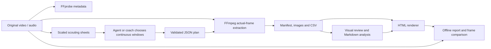

# Architecture

`model.py` validates timing, paths, crops and continuity declarations. `media.py`
probes and extracts images with passthrough timing. `render.py` embeds human-written
Markdown and validated evidence. `server.py` supports local byte-range playback.
`demo.py` generates public demonstration media without involving a real player.

The skill folder is self-contained and installable independently of repository
documentation/tests. The Python package uses the same implementation, with HTML,
CSS and JavaScript included as package resources. There is no frontend build step,
remote media upload, model API dependency or automatic coaching classifier.

No extraction operation writes to the input video. `render` deliberately updates
HTML only with `--overwrite`; extraction never reuses an existing output folder.
Tests check source-byte preservation and compare VFR frame timing to FFprobe.

中文：原视频只读；工具整理证据；agent/教练查看并写分析；页面合并完整报告
与连续帧。自动校验针对文件和时间轴，不代表自动完成动作判断。
